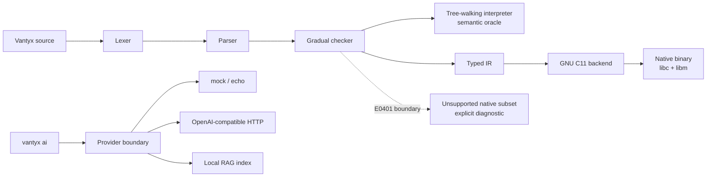

<p align="center">
  
</p>

<p align="center">
  <a href="https://github.com/zeiad6/vantyx/actions/workflows/ci.yml"></a>
  <a href="https://github.com/zeiad6/vantyx/releases"></a>
  <a href="LICENSE"></a>
  <a href="Cargo.toml"></a>
  
  
</p>

<p align="center">
  <a href="#language">Language</a> ·
  <a href="#ai-host">AI host</a> ·
  <a href="#benchmarks">Benchmarks</a> ·
  <a href="#documentation">Documentation</a> ·
  <a href="#creator">Creator</a>
</p>

Vantyx is a pre-1.0 programming language that starts like a script and scales to
native code. It combines Python-like indentation, optional static types, a
tree-walking interpreter that serves as the semantic oracle, and a GNU C11
backend for the statically typed subset. A dependency-free AI host adds
offline-first chat, embeddings, retrieval, and tool plumbing without putting a
model runtime inside the compiler.

> [!WARNING]
> Vantyx is a functional prototype, not production-ready. Native allocations are
> intentionally leaked in v0.1, there is no cycle collector or sandbox, and the
> native backend supports only a statically typed subset. Unsupported constructs
> are rejected with `E0401` rather than silently miscompiled. See
> [PROJECT_STATUS.md](PROJECT_STATUS.md) for the verified baseline and exact
> limits.

## Design goals

| Goal | Approach |
| --- | --- |
| **Simple by default** | Indentation blocks, `let`/`var`, optional annotations, no required `main` |
| **Checked by default** | Checked integer arithmetic, bounds checks, no null, no uninitialized values |
| **Gradual typing** | Prototype without annotations, then add types and compile the typed subset |
| **One semantics** | The interpreter is the oracle; native behavior is proven by differential tests |
| **Small and auditable** | Zero third-party Rust crates; generated C links only libc and libm |
| **AI at the boundary** | `vantyx ai` uses an explicit HTTP/provider boundary; no bundled or auto-downloaded models |

## Language

```vantyx
enum Shape:
    Circle(radius: Float)
    Rect(width: Float, height: Float)
    Point

fn area(shape: Shape) -> Float:
    match shape:
        Circle(radius):
            return 3.14159 * radius * radius
        Rect(width, height):
            return width * height
        Point:
            return 0.0

fn main():
    print(area(Circle(1.0)))
    print(area(Rect(2.0, 3.0)))
```

```text
3.14159
6.0
```

The v0.1 language includes functions, recursion, `if`/`elif`/`else`, `while`,
`for` over lists, strings, and maps, structs with reference semantics, closed
enums with payloads, exhaustive `match` with literals and guards, `List[T]`,
`Map[K,V]`, string interpolation, and file-based modules. Top-level or-patterns
such as `Circle(size) | Square(size)` share one binding set across alternatives,
nested payload patterns such as `Node(Leaf(value), _)` are checked by a
recursive pattern matrix and lowered natively with short-circuit tag tests, and
integer range patterns (`0..10`, `90..=100`) match in statements, expressions,
nested payload positions, and or-pattern alternatives. Native builds lower
top-level or-patterns with one shared binding set and ranges as comparison
chains.

```vantyx
import "lib/math.vtx"
from "lib/math.vtx" import add, Point
```

Imports are declaration-only, confined to the entry file's directory, checked
for cycles and limits, and work in both the interpreter and the native backend.
See the [language specification](docs/language_specification.md).

Basic file I/O works in both engines:

```vantyx
fn main():
    write_file("notes.txt", "compiled\n")
    append_file("notes.txt", "and verified\n")
    if file_exists("notes.txt"):
        print(read_file("notes.txt"))
```

Paths are host paths with the process's privileges, relative paths use the
process working directory, reads are capped at 64 MiB and must be valid UTF-8
without NUL bytes, and failures raise `R0015`. There is no sandbox and writes
are not atomic. See [ADR-0026](docs/decisions/ADR-0026-basic-file-io.md).

Single-level directory operations work in both engines:

```vantyx
fn main():
    make_dir("output")
    write_file("output/report.txt", "done\n")
    for name in list_dir("output"):
        print(name)
    remove_file("output/report.txt")
    remove_dir("output")
```

`list_dir` omits `.` and `..`, rejects non-UTF-8 entry names, and sorts entries
by UTF-8 bytes so output is stable. `make_dir` does not create parents,
`remove_dir` requires an empty directory, and `remove_file` removes a file or
symbolic link rather than a directory. These single-level operations follow
host permissions and fail with `R0015`. See
[ADR-0027](docs/decisions/ADR-0027-directory-operations.md).

Recursive directory creation and removal work in both engines:

```vantyx
fn main():
    make_dir_all("build/assets/icons")
    write_file("build/assets/icons/app.txt", "icon\n")
    remove_dir_all("build/assets")
    print(file_exists("build/assets"))
```

`make_dir_all` creates every missing parent, accepts an existing directory
(including a symbolic link to a directory), and treats an empty path as a
successful no-op. `remove_dir_all` removes a whole tree and unlinks symbolic
links instead of traversing them; trailing separators are trimmed before the
root type check so `remove_dir_all("link/")` unlinks the link. It fails with
`R0015` for a regular file, a missing path, or an empty path, and a failure can
leave a partial tree. Before any filesystem access it refuses `.`, `./`, `..`,
`../`, every root whose final component is `.` or `..` (including `link/.` and
`link/..`), and the filesystem root `/` including repeated-separator spellings;
ordinary roots such as `tree`, `./tree`, and `/tmp/tree` remain accepted. There
is no confirmation, rollback, trash, depth limit, entry-count limit, or sandbox,
and intermediate components such as `link/sub` can still reach through a
symlinked directory. See
[ADR-0031](docs/decisions/ADR-0031-recursive-directory-operations.md) and
[ADR-0035](docs/decisions/ADR-0035-refuse-destructive-removal-roots.md).

File metadata probes work in both engines:

```vantyx
fn main():
    write_file("notes.txt", "hello\n")
    print(file_size("notes.txt"))
    print(is_file("notes.txt"))
    print(is_dir("notes.txt"))
    print(is_symlink("notes.txt"))
    remove_file("notes.txt")
```

`file_size` follows symbolic links and requires an existing regular file; it
reports the host logical byte size (`st_size`), not allocated blocks or a
recursive directory size. `is_file` and `is_dir` follow symbolic links and
return `false` when metadata cannot be read, including missing paths, dangling
links, and permission failures. `is_symlink` observes the path itself and is
`true` for a link to a file, a link to a directory, and a dangling link.
`file_size` failures raise `R0015`; the predicates do not distinguish missing
paths from permission errors. No mode, owner, timestamp, ACL, inode, device, or
recursive-size query is exposed, and no metadata is modified or preserved. See
[ADR-0032](docs/decisions/ADR-0032-file-metadata.md).

Lexical glob expansion works in both engines:

```vantyx
fn main():
    make_dir_all("src/util")
    write_file("src/main.vtx", "fn main():\n    print(1)\n")
    write_file("src/util/math.vtx", "fn add(a: Int, b: Int) -> Int:\n    return a + b\n")
    write_file("src/.hidden.vtx", "")
    print(glob("src/**/*.vtx"))
    print(glob("src/*.vtx"))
    print(glob("src/.*"))
    remove_dir_all("src")
```

`glob` splits patterns on `/`; `*` matches zero or more Unicode scalar values,
`?` matches one, `[a-z]`/`[!a-z]` classes match scalar values, and a
whole-component `**` recurses without following symbolic links. Wildcards and
`**` skip dot entries unless the component explicitly allows them. Results are
lexical spellings sorted by UTF-8 bytes and deduplicated. Missing paths produce
no matches. Malformed patterns and more than 1,024 components raise `R0016`;
listing or `lstat` failures, non-UTF-8 entry names, more than 100,000 candidate
paths, and `**` depth beyond 128 raise `R0015`. There is no escaping, brace or
tilde expansion, case folding, normalization, sandbox, or streaming. See
[ADR-0033](docs/decisions/ADR-0033-glob.md).

Rename and byte-preserving copy are available in both engines:

```vantyx
fn main():
    write_file("draft.txt", "final\n")
    copy_file("draft.txt", "backup.txt")
    rename("draft.txt", "report.txt")
    print(read_file("report.txt"))
    print(read_file("backup.txt"))
    remove_file("report.txt")
    remove_file("backup.txt")
```

`rename` moves one file or directory and delegates overwrite behavior to the
host. `copy_file` requires a regular source file, creates or truncates the
target, and copies bytes exactly—including NUL and invalid UTF-8—without
preserving permissions, timestamps, or other metadata. Copies are not atomic,
source and target must be distinct, and failures raise `R0015`. See
[ADR-0029](docs/decisions/ADR-0029-rename-and-copy.md).

Recursive directory copy creates a new tree without merging:

```vantyx
fn main():
    make_dir_all("site/assets")
    write_file("site/index.html", "<h1>Vantyx</h1>\n")
    write_file("site/assets/style.css", "body {}\n")
    copy_dir_all("site", "site-backup")
    print(read_file("site-backup/assets/style.css"))
    remove_dir_all("site")
    remove_dir_all("site-backup")
```

`copy_dir_all` requires an existing source directory and a target that does not
exist; the target's parent must already exist. It rejects a target equal to or
inside the resolved source, never overwrites or merges, and leaves a partial
target on failure. Regular files are copied byte for byte and directories
recursively. Symbolic links in the source path are followed, but links and
special files below the source root are rejected with `R0015`. Entry names are
copied as raw bytes, so non-UTF-8 names are supported. No permissions,
timestamps, ownership, xattrs, ACLs, hard-link identity, or sparse layout is
preserved. Trees over 100,000 entries or directories beyond 128 levels below
the source root raise `R0015`. See
[ADR-0034](docs/decisions/ADR-0034-recursive-copy.md).

UTF-8 text builtins work in both engines:

```vantyx
fn main():
    let fields = split("alpha, beta, , gamma", ",")
    for field in fields:
        print(trim(field))
    print(join(["x", "y", "z"], "-"))
    print(starts_with("vantyx", "vtx"))
    print(ends_with("vantyx", "x"))
    print(replace("a-b-a", "a", "c"))
```

`split` preserves empty fields and treats an empty separator as a split into
Unicode scalar values. `trim` removes exactly Unicode `White_Space`, not
zero-width spaces. `replace` is literal, left-to-right, and non-overlapping;
an empty pattern raises `R0016`. There is no regular-expression engine, case
conversion, normalization, locale handling, or grapheme-cluster API. See
[ADR-0028](docs/decisions/ADR-0028-text-builtins.md).

Lexical path helpers work in both engines without touching the filesystem:

```vantyx
fn main():
    let source = path_join("data", "report.tar.gz")
    print(source)
    print(path_parent(source))
    print(path_name(source))
    print(path_stem(source))
    print(path_extension(source))
    print(path_is_absolute(source))
    print(path_join("/tmp", "run.txt"))
```

`path_join`, `path_parent`, `path_name`, `path_stem`, `path_extension`, and
`path_is_absolute` use `/` as the only separator. They do not normalize `.`,
`..`, or repeated separators, do not access the filesystem, and are not a
sandbox: an absolute child or a `..` component can escape the base. A final dot
is an extension separator only when it is neither the first nor the last byte,
so `.bashrc` has no extension. See
[ADR-0030](docs/decisions/ADR-0030-lexical-path-builtins.md).

## Status

| Area | Today |
| --- | --- |
| Interpreter | Complete for the v0.1 language; the semantic oracle |
| Native backend | Statically typed subset; typed IR, GNU C11 output, libc/libm only |
| Native support | Scalars, strings, `List[T]`, `Map[K,V]` with a scalar-key hash index, structs, enums, nested payload patterns, top-level or-patterns, integer range patterns, guarded `match`, `range(...)` values, imported declarations |
| Native boundaries | `Any`, `List[Any]`, `Map[Any,*]`, `Any` enum payloads, and `match` on `Any` are rejected with `E0401` |
| Pattern matching | Variant, wildcard, integer, string, and boolean patterns; nested payload patterns with recursive exhaustiveness; top-level or-patterns with consistent bindings; integer ranges with half-open and inclusive bounds; `Bool`-checked guards |
| Modules | `import` and `from ... import`; flat namespace, entry-directory confinement |
| File and directory I/O | UTF-8 `read_file`/`write_file`/`append_file`/`file_exists` plus `list_dir`/`make_dir`/`remove_file`/`remove_dir`/`make_dir_all`/`remove_dir_all` in both engines; sorted listings, 64 MiB read cap, symlink-safe recursive removal, destructive-root refusal for final `.`/`..` and `/`, fatal `R0015` errors, no sandbox |
| Metadata probes | `file_size`/`is_file`/`is_dir`/`is_symlink` in both engines; size follows symlinks and requires a regular file, predicates return `false` when metadata cannot be read, `is_symlink` uses `lstat` and sees dangling links; no metadata object or preservation |
| Glob | `glob` in both engines; Unicode `*`/`?`/classes, whole-component `**` without symlink traversal, explicit-dot hidden rules, byte-sorted deduplicated results, `R0016` malformed patterns, `R0015` I/O and caps; no escaping, braces, case folding, or sandbox |
| Rename/copy | `rename` and byte-preserving `copy_file` in both engines; host-defined rename overwrite, regular-file source check, no metadata preservation, non-atomic copies |
| Recursive copy | `copy_dir_all` in both engines; new target only, self-copy rejection, raw names, inner symlink and special-file rejection, 100,000-entry / 128-depth caps, no metadata preservation or rollback |
| Text | UTF-8 `split`/`join`/`trim`/`starts_with`/`ends_with`/`replace` in both engines; Unicode `White_Space` trimming, literal non-overlapping replacement, no regex/case/normalization |
| Paths | Lexical POSIX-style `path_join`/`path_parent`/`path_name`/`path_stem`/`path_extension`/`path_is_absolute` in both engines; no filesystem access, normalization, or containment |
| REPL | Persistent declarations, line editing, single-line history, top-level Tab completion, expression echo |
| AI host | Offline providers, streamed text chat, structured extraction, embeddings, BM25/semantic/hybrid retrieval, incremental vector reuse, MMR diversity reranking, citations, retrieval evaluation, tools, bounded agents; live cloud verification on 2026-11-24 and a 21/21 re-verification at 20:59Z (local model still missing; cloud access not guaranteed) |
| Memory | Interpreter is reference-counted; native allocations are leaked by design; no cycle collector |
| Tooling | `vantyx lint` (three conservative rules), fuzz smoke, differential fuzzer, benchmarks, docs; no formatter, LSP, package manager, or debug info |
| Production readiness | No stable ABI, no LTS, not recommended for production |

## Quick start

Requirements: a stable Rust toolchain and, for native builds, `clang` or another
C11 compiler via `VANTYX_CC`.

```sh
git clone https://github.com/zeiad6/vantyx.git
cd vantyx

cargo build --release
./target/release/vantyx run examples/hello.vtx
./target/release/vantyx check examples/enums.vtx
./target/release/vantyx lint examples/enums.vtx

./target/release/vantyx build examples/enums.vtx -o /tmp/enums
/tmp/enums

./target/release/vantyx repl
./target/release/vantyx ai providers
./target/release/vantyx ai chat --provider mock "hello"
```

`vantyx run` uses the reference interpreter. `vantyx build` generates C, invokes
the system compiler with `-O2`, and produces a standalone executable. Programs
that use `Any`, dynamic `match`, or other interpreter-only features must run
with `vantyx run`; the native compiler reports `E0401` instead of guessing.

## AI host

`vantyx ai` is an offline-first host CLI. It never bundles, downloads, or
executes a model, and remote HTTPS requires explicit opt-in.

```sh
# Deterministic offline providers
./target/release/vantyx ai providers
./target/release/vantyx ai doctor --provider mock
./target/release/vantyx ai chat --provider echo "hello"

# Validated JSON extraction with a bounded repair loop
./target/release/vantyx ai extract --provider mock --model demo \
  --schema examples/ai/person.schema.json \
  --response '{"name":"Ada","role":"engineer"}' \
  "Extract the person"

# Deterministic lexical embeddings (not a trained semantic model)
./target/release/vantyx ai embed --provider hash --model demo \
  --dimensions 8 --json "compiler" "native backend"

# Local retrieval with line citations and optional source filtering
./target/release/vantyx ai index --root docs --out /tmp/vtx-index.json \
  --provider hash --dimensions 32
# Re-embed only new or changed chunks; prune deleted documents
./target/release/vantyx ai index --root docs --out /tmp/vtx-index.json \
  --incremental --json
./target/release/vantyx ai search --index /tmp/vtx-index.json \
  --query "native map hash index" --top-k 5
./target/release/vantyx ai search --index /tmp/vtx-index.json \
  --query "hybrid retrieval" --source-prefix ai/ --top-k 5
# Suppress duplicate texts and spread results with deterministic MMR
./target/release/vantyx ai search --index /tmp/vtx-index.json \
  --query "hybrid retrieval" --diverse --top-k 5 --json
./target/release/vantyx ai eval --index /tmp/vtx-index.json \
  --fixture examples/ai/retrieval-eval.json --mode lexical --top-k 5 --json

# Offline model and dataset provenance (no download, no weight loading)
./target/release/vantyx ai inspect model.gguf --json
./target/release/vantyx ai inspect model.safetensors.index.json --metadata
./target/release/vantyx ai dataset examples/ai/train.jsonl --json
./target/release/vantyx ai dataset examples/ai/train.jsonl \
  --schema examples/ai/train.schema.json
# Deterministic train/held-out split (never overwrites existing files)
./target/release/vantyx ai split examples/ai/train.jsonl \
  --out-dir /tmp/vtx-splits --train-ratio 0.9 --seed 7 --json
# Remove exact duplicate records, keeping the first occurrence
./target/release/vantyx ai dedup examples/ai/train.jsonl \
  --out /tmp/vtx-train.unique.jsonl --json
# Write a deterministic seeded permutation (never overwrites existing files)
./target/release/vantyx ai shuffle examples/ai/train.jsonl \
  --out /tmp/vtx-train.shuffled.jsonl --seed 7 --json

# Any local OpenAI-compatible server (Ollama, llama.cpp, LM Studio, ...)
./target/release/vantyx ai models --endpoint http://127.0.0.1:11434/v1
./target/release/vantyx ai chat --provider openai --model qwen2.5:7b \
  --endpoint http://127.0.0.1:11434/v1 "Explain this error"

# Stream text deltas as they arrive (OpenAI-compatible providers only)
./target/release/vantyx ai chat --provider openai --model qwen2.5:7b \
  --endpoint http://127.0.0.1:11434/v1 --stream "Explain this error"
```

- Loopback HTTP is local; remote HTTPS needs `--allow-network` or
  `VANTYX_AI_ALLOW_NETWORK=1`.
- API keys are read only from the configured environment variable and are never
  written to project files, metrics, or errors.
- The cloud OpenAI-compatible path was exercised end to end against Gemini on
  2026-11-24 (chat, streaming, validated extraction, 768-dimension embeddings,
  RAG indexing/search, and retrieval evaluation). A retry was rejected with
  HTTP 400 `User location is not supported`, and a later re-verification at
  20:59Z using `MY_API_KEY` passed all 21 live checks after one transient 503,
  so live cloud access is not guaranteed. Evidence:
  [live verification](docs/ai/LIVE_VERIFICATION.md). No local model has been
  run; the 401/429/timeout paths are covered by a loopback harness.
- `--metrics` appends redacted JSONL with provider, model, latency, usage, and
  status, but no prompts, responses, or tool arguments.
- Retrieval indexes are strict, versioned JSON with atomic owner-only
  persistence. Search is linear over stored vectors; this is not a vector
  database.
- Incremental indexing reuses vectors for unchanged chunks and prunes deleted
  documents, but still walks and chunks the whole corpus. There is no
  file-manifest shortcut or partial-prefix merge.
- Retrieval returns cited chunks, not synthesized answers. Grounded generation
  is not claimed.
- `--diverse` applies deterministic MMR reranking with a fixed relevance weight
  of 0.7 and suppresses identical trimmed chunk text. It is a
  context-efficiency control, not evidence of better retrieval quality.
- Streaming chat prints text deltas only; streaming tool calls, interactive
  cancellation, and server-side constrained decoding are not implemented.
- Model downloads/removal, keyring storage, PDF/HTML/Office ingestion,
  arbitrary metadata filters, cross-source deduplication, measured reranking
  quality, and local-model evidence remain open. See
  [AI architecture](docs/ai/AI_ARCHITECTURE.md),
  [AI research](docs/ai/AI_RESEARCH.md), [AI security](docs/ai/AI_SECURITY.md),
  [ADR-0018](docs/decisions/ADR-0018-local-rag-index.md),
  [ADR-0023](docs/decisions/ADR-0023-streaming-chat.md),
  [ADR-0024](docs/decisions/ADR-0024-incremental-rag-index.md), and
  [ADR-0025](docs/decisions/ADR-0025-mmr-diversity-reranking.md).

Language-level AI syntax such as `from ai import Client` or `await` is not
implemented; it depends on async support. The supported AI surface is the host
CLI and its library modules.

## Architecture



The interpreter is the reference semantics. Every native feature must either
match it under differential tests or fail with `E0401` and a concrete help
message. The AI host is outside the compiler and has no third-party Rust
dependencies.

## Benchmarks

Measured on 2026-11-24 on one machine; identical output was verified before
timing, one warm-up was discarded, and medians are over five runs.

| Workload | Vantyx native | C `-O2` | Rust `-O` |
| --- | ---: | ---: | ---: |
| `arith_loop` | 2.726 ms | 2.838 ms | 3.055 ms |
| `enum_ops` | 3.646 ms | 3.766 ms | 4.529 ms |
| `fib` | 1.795 ms | 1.544 ms | 1.794 ms |
| `list_ops` | 2.738 ms | 2.223 ms | 2.526 ms |
| `map_ops` | 1.781 ms | 1.355 ms | 2.119 ms |
| `struct_ops` | 5.348 ms | 6.078 ms | 6.548 ms |
| `string_ops` | 1.565 ms | 1.242 ms | 1.799 ms |

`string_ops` fell from 8.318 ms to 1.565 ms in the latest run after single-byte
ASCII string iteration stopped allocating a heap string per character (T-055);
it now sits near C and Rust. `enum_ops` (T-056) shows native enum construction
and matching in the same band as C and Rust, so the heap-allocated enum
representation does not justify a rewrite yet. Concatenation still allocates a
fresh exact-size buffer. These are single-machine baseline numbers, not a
competitive claim; run-to-run load shifts the absolute medians. The interpreter
is intentionally the slow reference. Methodology, peak RSS, build time, binary
size, and raw results: [docs/benchmarks.md](docs/benchmarks.md) and
[`benchmarks/results/`](benchmarks/results/).

```sh
cargo build --release
python3 benchmarks/run.py --reps 5
python3 benchmarks/rag.py --reps 5 --docs 200 --dimensions 64
```

## Verification

The gate used for the current tree:

```sh
cargo build
cargo build --release
cargo clippy --all-targets -- -D warnings
cargo test
python3 tools/differential_fuzz.py --iterations 160 --seed 1
python3 tools/fuzz_smoke.py --binary target/debug/vantyx
```

Current local result (2026-11-24): **613 tests passed** (348 library unit +
15 CLI unit + 32 AI integration + 96 end-to-end + 122 differential native),
Clippy clean, debug and release builds succeed, all five examples match between
the interpreter and native binaries, and fuzz smoke reports controlled
diagnostics. The file, directory, recursive-directory, rename/copy,
recursive-copy, text, path, metadata, and glob native tests also pass under
`-fsanitize=address,undefined`
with leak detection disabled because v0.1 allocations are intentionally leaked. CI status
is tracked in [PROJECT_STATUS.md](PROJECT_STATUS.md); do not cite a test count
or CI result without checking the recorded evidence there and in
[TASKS.md](TASKS.md).

## Documentation

| Start here | Purpose |
| --- | --- |
| [Language specification](docs/language_specification.md) | Syntax, semantics, diagnostics |
| [Compiler architecture](docs/compiler_architecture.md) | Stage contracts and boundaries |
| [Type system](docs/type_system.md) | Gradual typing and `Any` rules |
| [Memory model](docs/memory_model.md) | Interpreter and native allocation behavior |
| [Roadmap](ROADMAP.md) | Track A/Track B priorities |
| [Project status](PROJECT_STATUS.md) | Verified baseline, limits, blockers |
| [Tasks](TASKS.md) | Acceptance criteria and verification records |
| [AI architecture](docs/ai/AI_ARCHITECTURE.md) | Provider, retrieval, and tool boundaries |
| [AI research](docs/ai/AI_RESEARCH.md) | Verified ecosystem survey and decisions |
| [AI security](docs/ai/AI_SECURITY.md) | Threat model and capability rules |
| [AI roadmap](docs/ai/AI_ROADMAP.md) | AI-0 through AI-8 exit gates |
| [Historical audit](RESEARCH/HISTORICAL_REQUIREMENTS_AUDIT.md) | Recovered requirements and gaps |
| [ADRs](docs/decisions/) | Architecture decisions and trade-offs |
| [Benchmarks](docs/benchmarks.md) | Methodology and raw results |
| [`llms.txt`](llms.txt) | Compact facts for AI assistants |
| [Contributing](CONTRIBUTING.md) | Build, test, and review rules |
| [Security policy](SECURITY.md) | Reporting and known limits |

## Repository map

| Path | Responsibility |
| --- | --- |
| `src/lexer.rs`, `src/parser.rs` | Indentation-aware lexing, recursive-descent/Pratt parsing |
| `src/checker.rs` | Name resolution, gradual types, exhaustiveness |
| `src/interp.rs` | Reference tree-walking runtime |
| `src/ir.rs`, `src/codegen_c.rs` | Typed IR and GNU C11 backend |
| `src/module.rs` | File-based module loader and confinement |
| `src/repl.rs` | Zero-dependency REPL editor, history, completion |
| `src/ai/` | JSON, providers, schema, extraction, embeddings, BM25/vector retrieval, RAG with incremental indexing, tools, agents, HTTP |
| `src/ai_cli.rs` | `vantyx ai` commands |
| `tests/e2e.rs`, `tests/native.rs`, `tests/ai.rs` | Language, differential native, and AI integration tests |
| `examples/` | Runnable Vantyx programs and AI fixtures |
| `benchmarks/` | Equivalent workloads and measurement runners |
| `docs/` | Specification, architecture, ADRs, research, launch kit |
| `.opencode/agents/` | Specialized engineering subagents |

## Known limits

- No generics, traits, closures, iterators, `Result`/`?`, async, concurrency,
  FFI, or package manager.
- No tuple patterns. Nested payload patterns, top-level or-patterns, and
  integer range patterns (`low..high`, `low..=high`) run in both the
  interpreter and native builds.
- Native allocations are never reclaimed in v0.1; there is no cycle collector.
- Struct, enum, list, and map keys use linear structural search in native maps;
  scalar keys use a hash index with a fixed seed.
- File and directory I/O is a small builtin slice: synchronous whole-file
  reads/writes, single-level directory operations, recursive creation and
  removal, lexical glob expansion, rename and byte-preserving regular-file copy,
  recursive directory copy, and read-only metadata probes with fatal
  `R0015`/`R0016` errors. There is no metadata object,
  mode/owner/timestamp query, recursive directory size, metadata preservation,
  streaming, recursive move, atomic copy/write, or sandbox. `list_dir` and
  each glob directory read the whole directory into memory, glob results are
  materialized, and recursive removal can leave a partial tree; there is no
  confirmation, rollback, glob cancellation, or directory entry-count limit.
  `copy_dir_all` never merges or overwrites, rejects inner symbolic links and
  special files, copies raw entry names, leaves a partial target on failure,
  and caps trees at 100,000 entries and 128 levels below the source root.
  There is no recoverable `Result`-based I/O.
- Glob patterns are lexical and deliberately smaller than shell globs: no
  escaping, braces, extglobs, tilde or variable expansion, case-insensitive
  matching, normalization, or `..` confinement. `**` does not descend through
  symbolic links, hidden trees are skipped unless a component is explicit, and
  non-UTF-8 entry names fail the expansion rather than being skipped. Caps are
  100,000 candidate paths, `**` depth 128, and 1,024 components.
- Path helpers are lexical and POSIX-only: no normalization, `..` confinement,
  Windows drive/UNC handling, filesystem resolution, or `Path` type. `path_join`
  takes two arguments and is not a sandbox.
- Text builtins are scalar/byte based: no regular expressions, case mapping,
  Unicode normalization, locale handling, or grapheme-cluster segmentation.
  `split`, `join`, and `replace` can allocate proportional to their inputs and
  outputs; there is no streaming text API or output-size cap.
- The linter has three conservative rules, no suppression or configuration, and
  no automatic fixes. There is no formatter, LSP, debug information, or stable
  ABI.
- The AI host has no live local-model evidence; a cloud OpenAI-compatible run
  was verified on 2026-11-24 and re-verified at 20:59Z with 21/21 checks, but
  access is not guaranteed. There is no
  tokenizer integration, tensor runtime, SIMD, GPU, MCP, or multimodal input.
- There is no sandbox. Untrusted model output and untrusted tools require
  application-level controls.

## Creator

<table>
  <tr>
    <td width="88" valign="top"></td>
    <td>
      <strong>Zeidex</strong> · <a href="https://github.com/zeiad6">@zeiad6</a><br>
      Creator and maintainer of Vantyx.<br>
      <a href="https://zeidexlink.zeidexsoft.com/zeidex">zeidexlink.zeidexsoft.com/zeidex</a> ·
      <a href="https://github.com/zeiad6/vantyx">github.com/zeiad6/vantyx</a>
    </td>
  </tr>
</table>

Contributions are welcome under [CONTRIBUTING.md](CONTRIBUTING.md). Report
security issues according to [SECURITY.md](SECURITY.md).

## License

MIT. See [LICENSE](LICENSE). Citation metadata is in [CITATION.cff](CITATION.cff).
