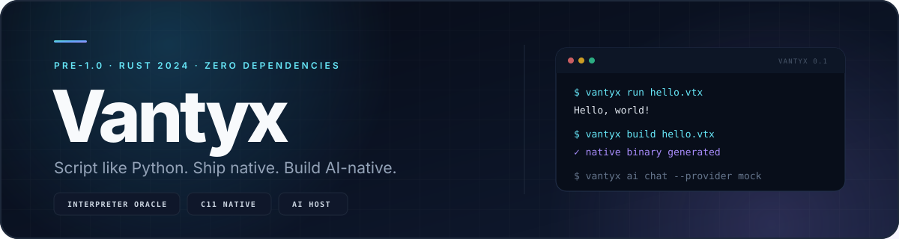
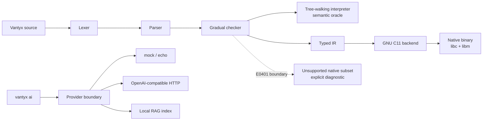

<p align="center">
  
</p>

<p align="center">
  <a href="https://github.com/zeiad6/vantyx/actions/workflows/ci.yml"></a>
  <a href="https://github.com/zeiad6/vantyx/releases"></a>
  <a href="LICENSE"></a>
  <a href="Cargo.toml"></a>
  
  
</p>

<p align="center">
  <a href="#language">Language</a> ·
  <a href="#ai-host">AI host</a> ·
  <a href="#benchmarks">Benchmarks</a> ·
  <a href="#documentation">Documentation</a> ·
  <a href="#creator">Creator</a>
</p>

Vantyx is a pre-1.0 programming language that starts like a script and scales to
native code. It combines Python-like indentation, optional static types, a
tree-walking interpreter that serves as the semantic oracle, and a GNU C11
backend for the statically typed subset. A dependency-free AI host adds
offline-first chat, embeddings, retrieval, and tool plumbing without putting a
model runtime inside the compiler.

> [!WARNING]
> Vantyx is a functional prototype, not production-ready. Native allocations are
> intentionally leaked in v0.1, there is no cycle collector or sandbox, and the
> native backend supports only a statically typed subset. Unsupported constructs
> are rejected with `E0401` rather than silently miscompiled. See
> [PROJECT_STATUS.md](PROJECT_STATUS.md) for the verified baseline and exact
> limits.

## Design goals

| Goal | Approach |
| --- | --- |
| **Simple by default** | Indentation blocks, `let`/`var`, optional annotations, no required `main` |
| **Checked by default** | Checked integer arithmetic, bounds checks, no null, no uninitialized values |
| **Gradual typing** | Prototype without annotations, then add types and compile the typed subset |
| **One semantics** | The interpreter is the oracle; native behavior is proven by differential tests |
| **Small and auditable** | Zero third-party Rust crates; generated C links only libc and libm |
| **AI at the boundary** | `vantyx ai` uses an explicit HTTP/provider boundary; no bundled or auto-downloaded models |

## Language

```vantyx
enum Shape:
    Circle(radius: Float)
    Rect(width: Float, height: Float)
    Point

fn area(shape: Shape) -> Float:
    match shape:
        Circle(radius):
            return 3.14159 * radius * radius
        Rect(width, height):
            return width * height
        Point:
            return 0.0

fn main():
    print(area(Circle(1.0)))
    print(area(Rect(2.0, 3.0)))
```

```text
3.14159
6.0
```

The v0.1 language includes functions, recursion, `if`/`elif`/`else`, `while`,
`for` over lists, strings, and maps, structs with reference semantics, closed
enums with payloads, exhaustive `match` with literals and guards, `List[T]`,
`Map[K,V]`, string interpolation, and file-based modules. Top-level or-patterns
such as `Circle(size) | Square(size)` share one binding set across alternatives,
nested payload patterns such as `Node(Leaf(value), _)` are checked by a
recursive pattern matrix and lowered natively with short-circuit tag tests, and
integer range patterns (`0..10`, `90..=100`) match in statements, expressions,
nested payload positions, and or-pattern alternatives. Native builds lower
top-level or-patterns with one shared binding set and ranges as comparison
chains.

```vantyx
import "lib/math.vtx"
from "lib/math.vtx" import add, Point
```

Imports are declaration-only, confined to the entry file's directory, checked
for cycles and limits, and work in both the interpreter and the native backend.
See the [language specification](docs/language_specification.md).

## Status

| Area | Today |
| --- | --- |
| Interpreter | Complete for the v0.1 language; the semantic oracle |
| Native backend | Statically typed subset; typed IR, GNU C11 output, libc/libm only |
| Native support | Scalars, strings, `List[T]`, `Map[K,V]` with a scalar-key hash index, structs, enums, nested payload patterns, top-level or-patterns, integer range patterns, guarded `match`, imported declarations |
| Native boundaries | `Any`, `List[Any]`, `Map[Any,*]`, `Any` enum payloads, and `match` on `Any` are rejected with `E0401` |
| Pattern matching | Variant, wildcard, integer, string, and boolean patterns; nested payload patterns with recursive exhaustiveness; top-level or-patterns with consistent bindings; integer ranges with half-open and inclusive bounds; `Bool`-checked guards |
| Modules | `import` and `from ... import`; flat namespace, entry-directory confinement |
| REPL | Persistent declarations, line editing, single-line history, top-level Tab completion, expression echo |
| AI host | Offline providers, streamed text chat, structured extraction, embeddings, BM25/semantic/hybrid retrieval, incremental vector reuse, citations, retrieval evaluation, tools, bounded agents |
| Memory | Interpreter is reference-counted; native allocations are leaked by design; no cycle collector |
| Tooling | Fuzz smoke, benchmarks, docs; no formatter, linter, LSP, package manager, or debug info |
| Production readiness | No stable ABI, no LTS, not recommended for production |

## Quick start

Requirements: a stable Rust toolchain and, for native builds, `clang` or another
C11 compiler via `VANTYX_CC`.

```sh
git clone https://github.com/zeiad6/vantyx.git
cd vantyx

cargo build --release
./target/release/vantyx run examples/hello.vtx
./target/release/vantyx check examples/enums.vtx

./target/release/vantyx build examples/enums.vtx -o /tmp/enums
/tmp/enums

./target/release/vantyx repl
./target/release/vantyx ai providers
./target/release/vantyx ai chat --provider mock "hello"
```

`vantyx run` uses the reference interpreter. `vantyx build` generates C, invokes
the system compiler with `-O2`, and produces a standalone executable. Programs
that use `Any`, dynamic `match`, or other interpreter-only features must run
with `vantyx run`; the native compiler reports `E0401` instead of guessing.

## AI host

`vantyx ai` is an offline-first host CLI. It never bundles, downloads, or
executes a model, and remote HTTPS requires explicit opt-in.

```sh
# Deterministic offline providers
./target/release/vantyx ai providers
./target/release/vantyx ai doctor --provider mock
./target/release/vantyx ai chat --provider echo "hello"

# Validated JSON extraction with a bounded repair loop
./target/release/vantyx ai extract --provider mock --model demo \
  --schema examples/ai/person.schema.json \
  --response '{"name":"Ada","role":"engineer"}' \
  "Extract the person"

# Deterministic lexical embeddings (not a trained semantic model)
./target/release/vantyx ai embed --provider hash --model demo \
  --dimensions 8 --json "compiler" "native backend"

# Local retrieval with line citations and optional source filtering
./target/release/vantyx ai index --root docs --out /tmp/vtx-index.json \
  --provider hash --dimensions 32
# Re-embed only new or changed chunks; prune deleted documents
./target/release/vantyx ai index --root docs --out /tmp/vtx-index.json \
  --incremental --json
./target/release/vantyx ai search --index /tmp/vtx-index.json \
  --query "native map hash index" --top-k 5
./target/release/vantyx ai search --index /tmp/vtx-index.json \
  --query "hybrid retrieval" --source-prefix ai/ --top-k 5
./target/release/vantyx ai eval --index /tmp/vtx-index.json \
  --fixture examples/ai/retrieval-eval.json --mode lexical --top-k 5 --json

# Any local OpenAI-compatible server (Ollama, llama.cpp, LM Studio, ...)
./target/release/vantyx ai models --endpoint http://127.0.0.1:11434/v1
./target/release/vantyx ai chat --provider openai --model qwen2.5:7b \
  --endpoint http://127.0.0.1:11434/v1 "Explain this error"

# Stream text deltas as they arrive (OpenAI-compatible providers only)
./target/release/vantyx ai chat --provider openai --model qwen2.5:7b \
  --endpoint http://127.0.0.1:11434/v1 --stream "Explain this error"
```

- Loopback HTTP is local; remote HTTPS needs `--allow-network` or
  `VANTYX_AI_ALLOW_NETWORK=1`.
- API keys are read only from the configured environment variable and are never
  written to project files, metrics, or errors.
- `--metrics` appends redacted JSONL with provider, model, latency, usage, and
  status, but no prompts, responses, or tool arguments.
- Retrieval indexes are strict, versioned JSON with atomic owner-only
  persistence. Search is linear over stored vectors; this is not a vector
  database.
- Incremental indexing reuses vectors for unchanged chunks and prunes deleted
  documents, but still walks and chunks the whole corpus. There is no
  file-manifest shortcut or partial-prefix merge.
- Retrieval returns cited chunks, not synthesized answers. Grounded generation
  is not claimed.
- Streaming chat prints text deltas only; streaming tool calls, interactive
  cancellation, and server-side constrained decoding are not implemented.
- Model downloads/removal, keyring storage, PDF/HTML/Office ingestion,
  arbitrary metadata filters, cross-source deduplication, reranking, and live
  model evidence remain open. See
  [AI architecture](docs/ai/AI_ARCHITECTURE.md),
  [AI research](docs/ai/AI_RESEARCH.md), [AI security](docs/ai/AI_SECURITY.md),
  [ADR-0018](docs/decisions/ADR-0018-local-rag-index.md),
  [ADR-0023](docs/decisions/ADR-0023-streaming-chat.md), and
  [ADR-0024](docs/decisions/ADR-0024-incremental-rag-index.md).

Language-level AI syntax such as `from ai import Client` or `await` is not
implemented; it depends on async support. The supported AI surface is the host
CLI and its library modules.

## Architecture



The interpreter is the reference semantics. Every native feature must either
match it under differential tests or fail with `E0401` and a concrete help
message. The AI host is outside the compiler and has no third-party Rust
dependencies.

## Benchmarks

Measured on 2026-11-24 on one machine; identical output was verified before
timing, one warm-up was discarded, and medians are over five runs.

| Workload | Vantyx native | C `-O2` | Rust `-O` |
| --- | ---: | ---: | ---: |
| `arith_loop` | 2.726 ms | 2.838 ms | 3.055 ms |
| `enum_ops` | 3.646 ms | 3.766 ms | 4.529 ms |
| `fib` | 1.795 ms | 1.544 ms | 1.794 ms |
| `list_ops` | 2.738 ms | 2.223 ms | 2.526 ms |
| `map_ops` | 1.781 ms | 1.355 ms | 2.119 ms |
| `struct_ops` | 5.348 ms | 6.078 ms | 6.548 ms |
| `string_ops` | 1.565 ms | 1.242 ms | 1.799 ms |

`string_ops` fell from 8.318 ms to 1.565 ms in the latest run after single-byte
ASCII string iteration stopped allocating a heap string per character (T-055);
it now sits near C and Rust. `enum_ops` (T-056) shows native enum construction
and matching in the same band as C and Rust, so the heap-allocated enum
representation does not justify a rewrite yet. Concatenation still allocates a
fresh exact-size buffer. These are single-machine baseline numbers, not a
competitive claim; run-to-run load shifts the absolute medians. The interpreter
is intentionally the slow reference. Methodology, peak RSS, build time, binary
size, and raw results: [docs/benchmarks.md](docs/benchmarks.md) and
[`benchmarks/results/`](benchmarks/results/).

```sh
cargo build --release
python3 benchmarks/run.py --reps 5
python3 benchmarks/rag.py --reps 5 --docs 200 --dimensions 64
```

## Verification

The gate used for the current tree:

```sh
cargo build
cargo build --release
cargo clippy --all-targets -- -D warnings
cargo test
python3 tools/fuzz_smoke.py --binary target/debug/vantyx
```

Current local result (2026-11-24): **457 tests passed** (297 library unit +
13 CLI unit + 30 AI integration + 44 end-to-end + 73 differential native),
Clippy clean, debug and release builds succeed, all five examples match between
the interpreter and native binaries, and fuzz smoke reports controlled
diagnostics. CI run 45365926013 passed on commit `e3d8bdd` with 457 tests;
T-047–T-053 are CI-verified, and a clean clone of the rewritten history passed
all 457 tests. Test counts and evidence are tracked in
[PROJECT_STATUS.md](PROJECT_STATUS.md) and [TASKS.md](TASKS.md); do not cite a
count without checking them.

## Documentation

| Start here | Purpose |
| --- | --- |
| [Language specification](docs/language_specification.md) | Syntax, semantics, diagnostics |
| [Compiler architecture](docs/compiler_architecture.md) | Stage contracts and boundaries |
| [Type system](docs/type_system.md) | Gradual typing and `Any` rules |
| [Memory model](docs/memory_model.md) | Interpreter and native allocation behavior |
| [Roadmap](ROADMAP.md) | Track A/Track B priorities |
| [Project status](PROJECT_STATUS.md) | Verified baseline, limits, blockers |
| [Tasks](TASKS.md) | Acceptance criteria and verification records |
| [AI architecture](docs/ai/AI_ARCHITECTURE.md) | Provider, retrieval, and tool boundaries |
| [AI research](docs/ai/AI_RESEARCH.md) | Verified ecosystem survey and decisions |
| [AI security](docs/ai/AI_SECURITY.md) | Threat model and capability rules |
| [AI roadmap](docs/ai/AI_ROADMAP.md) | AI-0 through AI-8 exit gates |
| [Historical audit](RESEARCH/HISTORICAL_REQUIREMENTS_AUDIT.md) | Recovered requirements and gaps |
| [ADRs](docs/decisions/) | Architecture decisions and trade-offs |
| [Benchmarks](docs/benchmarks.md) | Methodology and raw results |
| [`llms.txt`](llms.txt) | Compact facts for AI assistants |
| [Contributing](CONTRIBUTING.md) | Build, test, and review rules |
| [Security policy](SECURITY.md) | Reporting and known limits |

## Repository map

| Path | Responsibility |
| --- | --- |
| `src/lexer.rs`, `src/parser.rs` | Indentation-aware lexing, recursive-descent/Pratt parsing |
| `src/checker.rs` | Name resolution, gradual types, exhaustiveness |
| `src/interp.rs` | Reference tree-walking runtime |
| `src/ir.rs`, `src/codegen_c.rs` | Typed IR and GNU C11 backend |
| `src/module.rs` | File-based module loader and confinement |
| `src/repl.rs` | Zero-dependency REPL editor, history, completion |
| `src/ai/` | JSON, providers, schema, extraction, embeddings, BM25/vector retrieval, RAG with incremental indexing, tools, agents, HTTP |
| `src/ai_cli.rs` | `vantyx ai` commands |
| `tests/e2e.rs`, `tests/native.rs`, `tests/ai.rs` | Language, differential native, and AI integration tests |
| `examples/` | Runnable Vantyx programs and AI fixtures |
| `benchmarks/` | Equivalent workloads and measurement runners |
| `docs/` | Specification, architecture, ADRs, research, launch kit |
| `.opencode/agents/` | Specialized engineering subagents |

## Known limits

- No generics, traits, closures, iterators, `Result`/`?`, async, concurrency,
  FFI, or package manager.
- No tuple patterns. Nested payload patterns, top-level or-patterns, and
  integer range patterns (`low..high`, `low..=high`) run in both the
  interpreter and native builds.
- Native allocations are never reclaimed in v0.1; there is no cycle collector.
- Struct, enum, list, and map keys use linear structural search in native maps;
  scalar keys use a hash index with a fixed seed.
- No formatter, linter, LSP, debug information, or stable ABI.
- The AI host has no live local/cloud model evidence, tokenizer integration,
  tensors, SIMD, GPU, MCP, or multimodal input.
- There is no sandbox. Untrusted model output and untrusted tools require
  application-level controls.

## Creator

<table>
  <tr>
    <td width="88" valign="top"></td>
    <td>
      <strong>Zeidex</strong> · <a href="https://github.com/zeiad6">@zeiad6</a><br>
      Creator and maintainer of Vantyx.<br>
      <a href="https://zeidexlink.zeidexsoft.com/zeidex">zeidexlink.zeidexsoft.com/zeidex</a> ·
      <a href="https://github.com/zeiad6/vantyx">github.com/zeiad6/vantyx</a>
    </td>
  </tr>
</table>

Contributions are welcome under [CONTRIBUTING.md](CONTRIBUTING.md). Report
security issues according to [SECURITY.md](SECURITY.md).

## License

MIT. See [LICENSE](LICENSE). Citation metadata is in [CITATION.cff](CITATION.cff).
